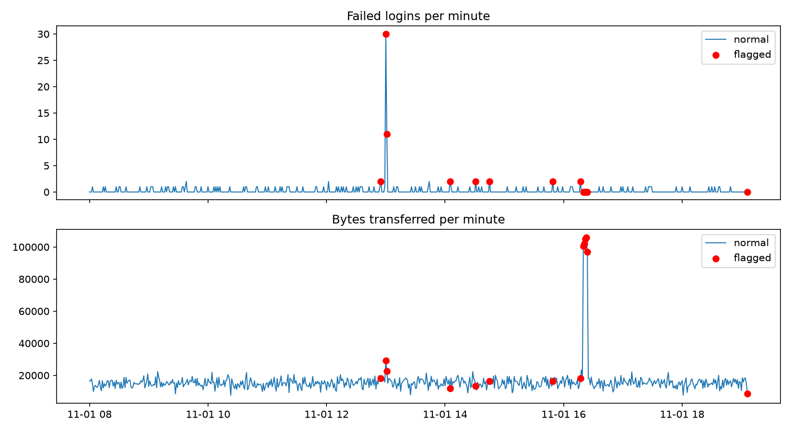

# Log Anomaly Detector

A Python tool that detects suspicious activity in server logs using a rule-based check
and an Isolation Forest machine learning model.

## What it does
- Generates ~2,000 simulated log entries (logins, failed logins, bytes transferred)
- Injects two attack patterns: a brute-force login burst and a data exfiltration spike
- Flags anomalies using (1) a rule: more than 5 failed logins per minute, and
  (2) Isolation Forest on per-minute features
- Plots flagged events

## Result

## How to run
pip install pandas numpy scikit-learn matplotlib
python detector.py